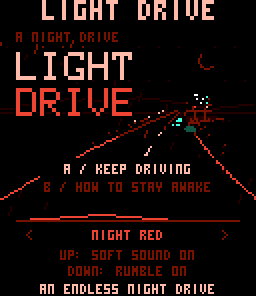

# Light Drive

A quiet, endless night drive for the **CHGame** handheld. Sleep narrows your vision while your foot gets heavier. Follow the neon arrows to wake up, and watch for wildlife. Four night palettes. Equally chill and alert, like a night drive.



I was inspired by the idea of a night drive, the peaceful effect it can have, yet the quiet danger of it too.In this game, you drive as long possible through the night, fighting to stay awake.

As time pass, your vision is tunnelling because of sleep, until it even blinks to dark. You can still drive, try to follow the line

passing by the neon signs wakes you up and restore your vision 

hitting crossing animals damage your car and makes it drift more, but wakes you up instantly

Speed control is inverted from the usual: your car is speeding up by default, because your foot is heavy on the pedal. You have to actively press B to lift your foot and slow down… but slow down too much and you won't reach the next neon

The game is compatible with my simple rumble pack add-on on GPIO1, and it really adds to the the gameplay, with small staccatos when drifting out of the road, a big short rumble when hitting an animal, and a long series when crashing and rolling.It was really fun to test and evolve it this weekend, and it is really close to the gameplay I had in mind. This play both chill and alert at the same time. Like a night drive.

Soft buzzer sounds and optional rumble. Your best distance stays on the SD card.

**Controls:** ←/→ steer · A start/retry · B brake · Select change color palette (including in game) · Start pause.

Install the [CHGame board package](https://github.com/bateske/CHGame#-get-started),
then open `LightDrive.ino` in Arduino IDE, or build with `arduino-cli`:

```sh
git clone https://github.com/juliendorra/light-drive.git LightDrive
cd LightDrive
arduino-cli compile --fqbn CHGame:ch32v:rev0:opt=oslto,rtlib=nano,periph=game,usb=uploadonly --output-dir build .
```

Game source and original [pixel artwork](art/) are MIT licensed.
Visual inspiration: [Kravennart’s “Night drive, 4 colors”](https://www.reddit.com/r/PixelArt/comments/1xkeudl/night_drive_4_colors/).
