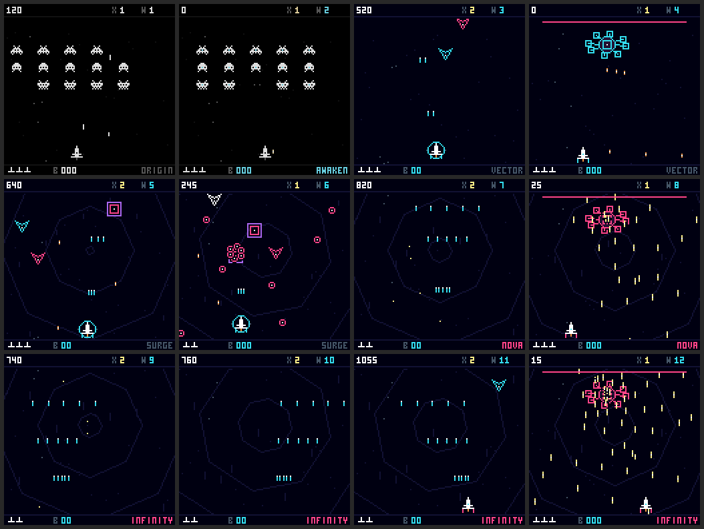

# Wave captures

Key moments from the first 12 waves of Void Bloom 1.1.2. The game continues endlessly after wave 12.

| Wave | GIF | Duration | Key moment |
|---|---|---|---|
| 1 | [wave-01-origin.gif](wave-01-origin.gif) | 6s | Marching formation and single-shot fire |
| 2 | [wave-02-awaken.gif](wave-02-awaken.gif) | 6s | Charge, upward loop, committed dive, and return |
| 3 | [wave-03-vector.gif](wave-03-vector.gif) | 6s | Free flight and twin shot against moving attackers |
| 4 | [wave-04-first-boss.gif](wave-04-first-boss.gif) | 10s | Rings, aimed fans, rotating streams, and recovery beats |
| 5 | [wave-05-surge.gif](wave-05-surge.gif) | 6s | Three-way spread and the first radial volleys |
| 6 | [wave-06-focused-spread.gif](wave-06-focused-spread.gif) | 6s | Spread fire and dodging between turret volleys |
| 7 | [wave-07-nova.gif](wave-07-nova.gif) | 6s | Five-way fire through weaving attackers |
| 8 | [wave-08-nova-boss.gif](wave-08-nova-boss.gif) | 10s | Denser boss rings, fans, and rotating streams |
| 9 | [wave-09-infinity.gif](wave-09-infinity.gif) | 6s | Full-power fire and stronger moving enemies |
| 10 | [wave-10-panic-bomb.gif](wave-10-panic-bomb.gif) | 6s | A bomb clears a barrage before the attack resumes |
| 11 | [wave-11-endless-pressure.gif](wave-11-endless-pressure.gif) | 6s | Full-power fire under sustained pressure |
| 12 | [wave-12-infinity-boss.gif](wave-12-infinity-boss.gif) | 10s | The first full-progression boss and its largest patterns |

Recorded from the real CHGame simulator framebuffer at 384 × 384, with nearest-neighbor scaling. Each GIF preserves game speed: six 60 Hz updates per 100 ms frame. Each file is smaller than 1 MB.

Wave starts are staged using a separate simulator-only capture build. Damage is enabled; controls use normal movement, fire, focus, and bombs; later waves replay the delayed-observation pilot. These are showcase clips, not a continuous playthrough or a claimed no-hit run. The capture command is absent from release firmware.

Recreate with `python tools/capture_levels.py` from the game folder. [manifest.json](manifest.json) records hashes, timing, sizes, and observed bullet peaks.
