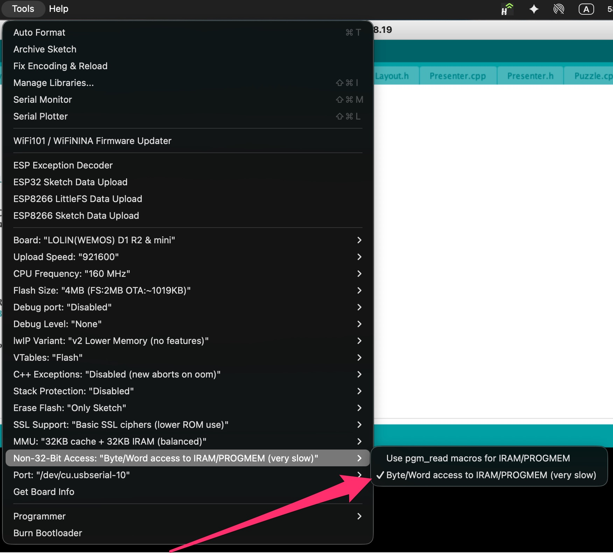

# ESPboy_CHCore

CHGame and CHGfx libraries by bateske ported by RomanS to compile CHGames for ESPboy (www.espboy.com).

This library replaces hardware-specific CH32V calls (DMA, SPI, timers, flash) with ESP8266-compatible equivalents:
- **Graphics:** Double-buffered async chunk rendering via `nbSPI`.
- **Audio:** `Ticker.h` background sequencer using `ESPboy.playTone()`.
- **Input:** MCP23017 button polling via `ESPboy.getKeys()`.
- **Save:** Persistent storage using ESP8266 `EEPROM` emulation.

## How to Port a CHGame to ESPboy

1. **Install this library**: Place the `ESPboy_CHCore` folder inside your `Arduino/libraries/` directory.
2. **PROGMEM Optimization**: To save RAM, it's better to add `PROGMEM` to all `const` heavy arrays in the game's source. 
3. **Fix the `.ino` file**: Delete 1 line and add 4 lines:
   
a) Delete
```cpp
#include <CHGame.h>
```
b) Add at the beginning of .ino
```cpp
#include <ESPboy_CHCore.h>
ESPboyInit myESPboy;
```
c) Add at the beginning of setup(){};
```cpp
myESPboy.begin("GAME_NAME");
gfx_init();
```
4. Mandatory Arduino IDE Setting: Before compiling, you MUST change the memory access setting to allow the code to read PROGMEM arrays correctly. In the Arduino IDE menu, go to Tools -> Non-32-Bit Access and select "Byte/Word access to IRAM/PROGMEM (very slow)".



5. SD Card to PROGMEM Migration: The ESPboy (ESP8266) has about 1MB of available Flash memory for the compiled sketch. If the original game relies on loading assets from an SD card, it is highly recommended to convert all this data into PROGMEM C-arrays. You will need to adjust the game's file-reading logic to read directly from PROGMEM instead of the SD card.
